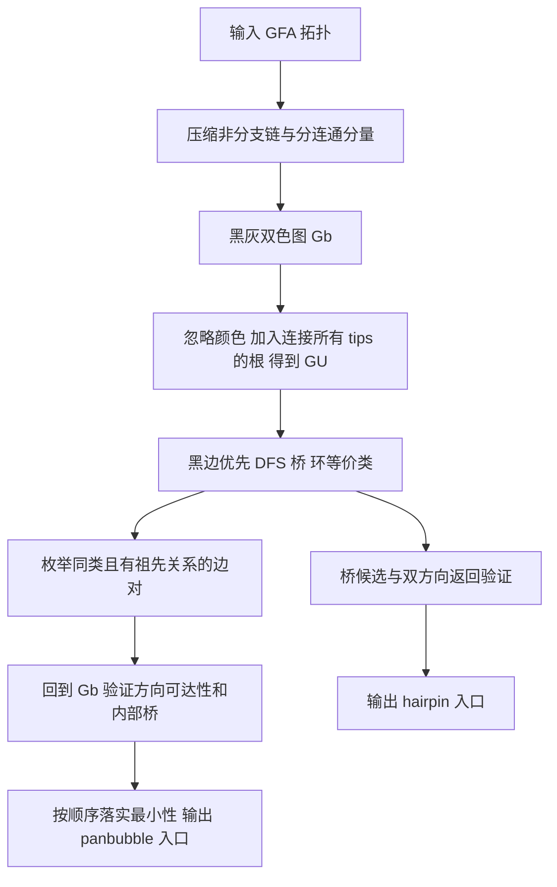

# 《Billi: Accurate and Scalable Bubble Detection in Pangenome Graphs》精读笔记

| 项目 | 内容 |
| --- | --- |
| 作者 | Shreeharsha G. Bhat、Daanish Mahajan、Chirag Jain |
| 版本 | bioRxiv 预印本 v2，2026-10-16；DOI：10.1101/2025.11.21.689636 |
| 阅读材料 | 同目录 [full.md](full.md)、图像和本地 PDF；正文约 13 页，不含独立 Supplementary Document |
| 笔记日期 | 2026-10-19 |
| 软件 | 论文给出的项目地址：<https://github.com/at-cg/billi>；本文未运行该软件 |

**核心洞见：允许复杂路径并不必然破坏变异层级；关键是把从两个入口穿过的区域，与从一个入口进入后反向返回的区域分开定义。**

这里的 accurate 主要是相对于图结构定义的正确性，不能直接读成生物学变异检测的准确率。Billi 枚举的是入口和由入口限定的区域，不负责从测序数据调用基因型，也没有在大规模变异真值集上报告 precision/recall。

本文保留论文的章节、定义、定理和表号作为定位。原文 Markdown 部分字符损坏，关键定义已对照本地 PDF 文本和图像核查。所有完整证明都被论文放在独立补充材料中，本地文件未包含该材料。下面给出的证明直觉与小例子不冒充补充证明；补充表中的版本、命令和具体统计也不作补写。

## 重建知识边界与作者的思考路径

### 从前人已经解决的问题出发

基因组组装最初需要识别这样一种局部图结构：一段共同序列分岔，沿不同序列走一段，随后重新汇合。不同路径可能来自测序错误、杂合变异或近似重复。Onodera、Sadakane 和 Shibuya 的 superbubble（2013）把这个直觉变成了有向图上的定义。无环、封闭的边界以及最小性，使区域既容易识别，又能递归组织。

后来问题变了。泛基因组不只想消除组装中的局部歧义，还想保留真实的大型重排。DNA 有两个方向，表示同一段序列正向与反向的能力不能丢；倒位、重复又可能形成带环结构。Paten 等人的 ultrabubble/snarl（2018）把问题推进到双向图。Ultrabubble 保留无环限制，snarl 放开这个限制，但主要靠可分离性和最小性来限定区域。一个能从图上切下来的区域，未必能按 DNA 的方向约束从一端走到另一端。

Li、Marin 和 Farhat 的 Pangene/bibubble（2024）进一步要求区域中的顶点能处在入口到出口的合法行走上。这已经很接近 Billi。真正还没有解决的是：允许环之后，两个都符合局部条件的区域可能交叉重叠。它们共享一部分，却谁也不是谁的完整子区域。这样无法直接把所有结果组织成一棵变异层级树。

这里被放弃的隐含假设是：**只要局部区域可分离、可穿行，再加最小性，就足以保证全局结果互不交叉。** 对 bibubble，这个推断在一般图上不成立。Billi 的引言明确针对 Pangene 论文 §2.6 中未经证明的严格嵌套主张，给出 Fig. 1D 和补充 Fig. S1 反例。这不是调大搜索半径可以修好的问题，因为冲突来自定义本身。

### 怎样从这个失败走到本文的选择

以下是依据论文组织重建的研究路线，不是作者真实实验日志。

最朴素的修补是取消无环限制。这样倒位区域进来了，但不可穿行的枝杈和交叉重叠也进来了。再加上 traversability，可以排除不能参与入口间行走的顶点，却仍不能排除所有 bibubble 重叠。再像 compatible snarls 一样，从结果中选一个互不交叉子集，的确能得到层级，但层级来自筛选策略，原定义的全部结果仍然相互冲突。

还有一种选择：追问造成冲突的单入口反向返回结构，是不是本来就不该与双入口结构混在一起。对由反向重复包围的倒位，进入一个区域后以相反方向返回同一段边界序列，比硬指定两个不同入口更符合图的形状。于是把这类区域单独叫 hairpin，让 panbubble 的内部排除特定 hairpin 入口。这样不是简单少报几个结果，而是改变结构的分类，再证明两类结构的集合关系。

作者的底气有三层。最硬的一层是严格嵌套的定理声明：有效区域之间的关系被限定成不交或包含。第二层是能把受方向限制的图问题转到无向图的桥、DFS 和环等价类上筛选，借用成熟算法。第三层是已知 Y 染色体倒位的图实例，能直接检验边界与内部 SNP 是否被合理组织。三者分别回答定义是否自洽、算法能否落地、抽象是否具有生物学解释力。

不能反推作者一定先发现了 hairpin 再推定理，也不能从正文猜测审稿意见。本文是预印本，材料没有提供这种研究过程证据。

### 四个核心问题

| 问题 | 本文实际回答 |
| --- | --- |
| **Problem** | 在紧凑双向泛基因组图上，枚举允许环、保留合法穿行、且所有输出区域具有严格嵌套关系的结构入口。 |
| **Motivation** | 同一个大型倒位可能包含小变异；需要既保留复杂事件，又清楚表示其内部子变异，避免边界交叉使层级含义不确定。 |
| **State of Research / Gap** | Superbubble/ultrabubble 能给出整齐结构但排除环；snarl/flubble 允许环却不保证每个顶点都参与入口间行走；bibubble 补上穿行但仍可能交叉。VG 的兼容筛选解决输出冲突，不等于原定义自然满足嵌套。 |
| **Contribution** | 在 bibubble 附近作有针对性的定义增量：单列 hairpin、限制 panbubble 内部的 hairpin 入口，并给出严格嵌套与判定定理；据此构造精确枚举和更快的经验候选裁剪。 |

真正推进的是**带环图中变异区域的结构定义与枚举**。没有提出新的图构建器、序列比对器或完整变异调用系统。

## 1. Abstract｜全篇压缩

### 1.1 Task

输入紧凑的 biedged graph，输出所有 panbubble 的两个入口和所有 hairpin 的单个入口。目标同时包含表示能力、结构一致性与运行资源。

### 1.2 Technical challenge for previous methods

无环定义遗漏带环区域；只放开无环限制又不能同时保证穿行与层级。最接近的 bibubble 已支持环和穿行，新增缺口是交叉重叠。

### 1.3 Key insight

把双入口穿行区域与单入口反向返回区域分开，并限制二者的包含方向，使复杂结构也能拥有稳定的层级。

### 1.4 Technical contributions

- 定义 panbubble 与 hairpin，并给出三种相交关系的定理：panbubble 之间严格嵌套；panbubble 与 hairpin 相交时前者在后者内部；不同 hairpin 不交。
- 建立辅助无向多重图上的必要充分判据，结合桥、环等价类和方向可达性验证。
- 精确枚举耗时 $O(n^2(n+m))$；默认启发式把 panbubble 的每个起始边限制到首个合适后继，耗时界降到 $O(n(n+m))$。其中 $n=|V_b|$、$m=|E_b|$。

### 1.5 Experiment

14 张图涵盖 6 种构图工具。能够完成精确计算的 10 张图上，默认算法与精确算法输出相同；其余 4 张图的精确算法在 24 小时内未完成。HPRCv2.0 上默认 Billi 用时 4,361 秒、峰值内存 90,043 MB；VG 为 72,668 秒、566,882 MB。已知 46 kbp 的 Y 染色体倒位用 hairpin 表示，内部变异用 panbubble 表示。证据定位：§5、Fig. 4、Tables 1–2。

## 2. Introduction｜本文真正要解决的缺口

### 2.1 任务与应用

泛基因组图把多个基因组的序列与邻接放在同一个对象中。一个区域内的不同合法走法，可以代表不同序列选择。识别区域之后，才有机会讨论等位序列、变异之间的包含以及下游目录化。

要分开三个层次：图上存在合法 walk；该 walk 被某条真实单倍型走过；该 walk 对应一个被验证的变异。Billi 直接约束第一层，Fig. 4 为特定实例提供第二、第三层支持。仅靠拓扑不会自动保证所有组合路径都是观测过的单倍型。

### 2.2 三类技术瓶颈

| 前作与机制 | 具体限制 | 根因 | 本文新增要求 |
| --- | --- | --- | --- |
| Superbubble；ultrabubble | 图内有环时不属于定义，MUC4 和模拟倒位图中可见 | 无环性是定义条件，算得更快也不会找回这些结构 | 允许环但保留区域性质 |
| Snarl；flubble | 区域可包含不能参与入口间合法 walk 的顶点 | 普通图的切分条件不足以表达黑灰边交替和方向 | 把 traversability 写进定义与验证 |
| Bibubble；Pangene | 两个区域可能交叉，无法全量形成层级 | 局部最小性不足以限制带环结构的所有交叠方式 | 区分 hairpin，并证明全局嵌套 |

这张表说的是定义。实测还叠加了软件策略：VG 输出经过筛选的 snarls，Pangene 默认只查距离不超过 100 的环等价边对。程序漏报和定义拒绝必须分别讨论。

### 2.3 解决路线与贡献边界

定义层先改变允许的区域，再证明这些区域具有所需关系。算法层利用无向图快速缩小候选，但回到原图检查方向。实现层进一步少查候选，换取大图可运行性。

no-hairpin 是定义层的承重条件；方向可达性是保证序列含义的承重条件；最近候选裁剪是实际扩展性的关键选择。论文没有逐项删除这些部件的大型消融，不能给它们分配独立性能提升比例。前三者的作用分别来自定理、判据和精确/启发式对照。

### 2.4 已展示的应用

Yq11.221 的 46 kbp recurrent inversion 是最清楚的展示。作者对照 HG01106 与 T2T-CHM13 的路径方向，并用组装片段的 dot plot 验证倒位。Hairpin 限定倒位区域，内部 panbubble 表示小变异。它展示了结构层级的价值，没有证明每一个 hairpin 都是倒位。

## 3. Method｜从 DNA 方向到可枚举的区域

### 3.1 Overview：这里的模块是定义、判据与枚举环节



精确版与默认版主要分叉在候选枚举：精确版遇到失败候选仍继续找；默认版只检查首个合适后继。Hairpin 检测两版都采用精确过程。

### 3.2 图表示：顶点是序列端点，黑边才是序列

双向图（bidirected graph）的一个序列节点有两个端。论文把一个序列节点拆成两个顶点，以一条黑边连接，得到双色边图（biedged graph）。灰边表示不同端点的邻接。每个顶点恰有一条黑边，因此黑边组成端点的配对。

| 符号 | 类型、大小与含义 |
| --- | --- |
| $G_b=(V_b,E_b,f_b)$ | 无向双色多重图；$n$ 个端点、$m$ 条边，颜色函数区分黑灰 |
| $\hat v$、$e_v$ | 与 $v$ 通过唯一黑边配对的端点；$e_v=\{v,\hat v\}$ |
| $U(s,t)$ | 从 $s$ 出发，不把 $s,t$ 用作中间顶点时能出现的端点集合 |
| $B(s,t)$ | $U(s,t)\setminus\{s,t\}$，panbubble 的区域顶点集合 |
| $Y(s)$ | 从 $s$ 出发、不把 $s$ 用作中间顶点时能出现的端点集合 |
| $G_U$ | 辅助无向多重图；保留原边，新增一个根与到 tips 的边 |
| $A_d,A_f$ | 长度约 $n+1$ 的 DFS 发现、完成时间数组 |
| $A_{bridge}$ | 长度 $n$ 的布尔数组，标记对应黑边在 $G_U$ 中是否为桥 |
| $W_s,W_t,W$ | 长度 $n$ 的布尔数组，记录从该方向端点出发能否在限制内结束于入口 |

合法 walk 必须从黑边开始、在黑边结束，中间黑灰交替。例如：

$$s\xrightarrow{黑}\hat s\xrightarrow{灰}a\xrightarrow{黑}\hat a\xrightarrow{灰}\hat t\xrightarrow{黑}t.$$

每跨过黑边就读完一段序列，再跨灰边进入下一段。普通无向图中连续走两条灰边虽然连通，却没有读完中间序列，在这里不合法。Walk 可以重复顶点和边，所以比 simple path 宽松，正好容纳环。

**从 $u$ 能遇见 $v$，不等于从 $v$ 出发能回到 $u$。** 前者可能只是把 $v$ 作为某条黑边的进入端。反转整条合法 walk 仍合法，但反转起点是原 walk 的最终端点，不是其任意中间端点。很多错误实现从普通无向图直觉出发，把这两件事混在一起。

论文的“不经过入口”允许入口作为起点或终点，禁止入口出现在中间。若理解成删除入口顶点，连正常的入口到出口 walk 都会被误删。

压缩的规则也与端点有关。若灰边 $\{u,v\}$ 两端各自只有这一条灰边，且二者不是同一黑边的配对端点，就把两段黑边接成 $\{\hat u,\hat v\}$，删除 $u,v$。例如黑边 $a-u$、$v-b$ 与灰边 $u-v$ 被替换成一条黑边 $a-b$。黑灰平行边不能按这个规则合并，否则可能抹掉真实的环结构。

### 3.3 Hairpin：从同一入口反向返回

对于入口 $s$，先取 $Y(s)$。定义 1 要求三件事。

区域中每个顶点都能出现在一条从 $s$ 出发的 inverted closed walk 上。这类 walk 开头是 $s,\hat s$，结尾是 $\hat s,s$，即末尾沿入口黑边反方向走回来。它与普通 closed walk 不同，普通 closed walk 末尾仍以最初方向重复入口黑边。

删除入口黑边 $e_s$ 后，$Y(s)\setminus\{s\}$ 与图的其余部分分开。这样入口的确控制整个区域，而不是任意一条可反向返回的路径。

还要求区域中没有其他入口满足前述条件。这个最小性把可继续向内缩小的候选排除，避免同一串入口都被报告为独立 hairpin。

输出区域不包括 $s$，也不包括入口黑边。后文的集合包含关系必须遵守这一约定。

### 3.4 Panbubble：五个条件各自在排除什么

定义 2 的入口是 $s,t$，要求 $s\ne t$ 且 $s\ne\hat t$。

**Matching** 要求 $U(s,t)=U(t,s)$。两个入口看到的封闭区域必须一致。如果从一侧还能走进另一侧根本不能到达的枝杈，这个候选立即失败。

**Separable** 要求删除 $e_s,e_t$ 后，$B(s,t)$ 与剩余图断开。它排除隐藏的第三个对外连接，保证边界真的限定了区域。

**Traversability** 要求 $U(s,t)$ 每个顶点至少出现在一条 $s$ 到 $t$ 的合法 walk 上。不是所有顶点都要处在同一条 walk 上，也不要求 walk 不重复顶点。这个量词足够保证各局部序列能参与某种入口间穿行，但不会枚举所有等位序列。

**No-hairpin** 禁止 $B(s,t)\setminus\{\hat s,\hat t\}$ 中存在 hairpin 入口。两个边界内侧端点被特意排除，不能把条件缩写成区域里不许有任何与 hairpin 有关的顶点。关键是禁止的入口位置。

**Minimality** 要求固定一个入口后，不能在当前区域中找到另一个更近的合法入口配对。对 $s$ 和 $t$ 两侧都要求这一点。它不禁止完整的内部 panbubble：内部结构可以用另外两个入口，因此不构成对外部某一入口的更近替代。

同样，$s,t$ 与两条入口黑边不属于 $B(s,t)$，$\hat s,\hat t$ 属于内部。把整个边界黑边也算入内部，会误判相邻结构的共享与嵌套。

### 3.5 为什么转成普通无向图，还不能只在普通无向图中计算

原图的合法 walk 很难直接套用标准切边算法。作者复制所有顶点和边并忽略颜色，新增根 $v_{src}$，连接所有 tips。Tip 是没有灰边的端点。每个连通分量分别处理，且每个分量都需要至少一个 tip。

根连接所有 tips 的作用，是把外部边界统一接到图外。例如一条线性骨架两端的黑边，在未加根的图中可能分别是桥；加根连接两端后，会出现经过两条边的外部回路。这样区域的两个入口可以表现为一组环等价边。根必须放在可证明位于区域之外的位置，tips 正好满足这个要求。

每个顶点的邻接表先放黑边。DFS 从新根开始，原黑边都会成为树边。理由可以直接核验：若首次发现 $u$ 时其配对点 $\hat u$ 未访问，下一步必先访问 $\hat u$；若配对点已访问，配对点第一次被访问时就会先通过黑边发现 $u$。这依赖从新增根进入原图的遍历设定。

DFS 后，树边 $e$ 的 bracket set 是从 $e$ 下方子树连回 $e$ 上方祖先的回边集合。删掉 $e$，若还有这样的回边，子树仍可连回上方；若没有，$e$ 就是桥。这也解释了为何用 Tarjan 的线性桥检测就能得到 $A_{bridge}$。

多重图中的平行边必须按边身份区分。两端之间有黑灰两条边时，删掉一条仍能通过另一条连通。只按父顶点跳过回边的简化桥检测，会把这类边错误标为桥。

两条边 cycle-equivalent 的意思是：任意一个环要么同时包含二者，要么同时不包含二者。它不是二者恰好出现在同一个环中。后一个条件远弱于前一个。所有桥都不出现在任何环中，所以按照这一定义，桥之间也可能属于同一等价类；等价并不自动意味着合法 bubble。

本文借用 Johnson、Pearson、Pingali 的 program structure tree 工作（1994）计算环等价类。借工具的关键收益是廉价地找出具有合适无向切分关系的候选，而不是把 DNA 方向问题消掉。候选仍必须回到 $G_b$ 验证。

### 3.6 定理 1：四项判据与方向可达性

忽略 minimality 时，正文定理 1 给出必要充分条件。两条入口黑边必须在同一条 DFS 根到叶路径上，端点次序为

$$\bar s\prec\overline{\hat s}\prec\overline{\hat t}\prec\bar t,$$

或完全对称的另一方向。$\prec$ 表示严格祖先关系，不是简单编号更小。两条入口边还必须环等价。

剩下两项是原图的方向穿行，以及内部桥不能从两入口的 DFS 主路径分岔出去。这里有一个容易漏掉的细节：**内部黑边为桥并不一律非法**。定理允许位于两入口之间祖先链上的桥；被排除的是不满足相应位置条件的桥。

验证穿行时计算 $W_s[v]$：从 $v$ 出发，存在合法 walk 结束于 $s$，且不把 $s,t$ 作为中间顶点，则记 1。$W_t$ 同理。

为何从 $s$ 向内做 DFS，更新的却是 $W_s[\hat u]$？因为当前状态 $u$ 表示准备从 $u$ 走黑边到 $\hat u$。从 $s$ 走到并读完这条黑边后，可以反转整个 walk，得到从 $\hat u$ 到 $s$ 的 walk。因此标记的是配对端点。操作可写成以下说明性伪代码：

```text
visit(u):
    若 u 已访问，返回
    标记 u 已访问
    W_s[hat(u)] = 1
    若 u 是 hat(s) 或 hat(t)，返回
    对 hat(u) 的灰边邻居 w：visit(w)
```

停止在 $u=\hat s$ 或 $\hat t$，是因为再走黑边就读到入口端点，之后不能继续离开入口。这里显式只列灰边邻居；黑边返回当前已访问状态，不能产生新的合法扩展。

接着对每条黑边的两个端点检查：

$$
[W_s[v]\land W_t[\hat v]]\;\lor\;
[W_s[\hat v]\land W_t[v]]\;\lor\;
[\neg W_s[v]\land\neg W_s[\hat v]\land\neg W_t[v]\land\neg W_t[\hat v]].
$$

第一项表示黑边两端分别能结束于两个入口；第二项允许反向；第三项说明这条黑边完全不在候选触及的区域。若只接到一个入口，或两端方向不配合，三项就全为假。

这里不需要求出具体 walk 列表。两个长度 $n$ 的布尔数组压缩了验证所需的信息，单个候选的最坏耗时是 $O(n+m)$。

内部桥的祖先关系可用时间戳判断：$x$ 严格祖先于 $y$ 当且仅当 $d[x]<d[y]$ 且 $f[y]<f[x]$。因此扫描内部相关黑边时，每次位置测试只需常数时间。

### 3.7 定理 2：Hairpin 的验证

Hairpin 入口 $s$ 的黑边在辅助图中必须是桥。在 $s$ 下方，除指定的边界端点外，不能再出现对应黑边为桥的顶点。这是最小性在辅助图上的判据。

再计算结束于 $s$ 的方向可达数组 $W$。对每一条黑边，两个端点必须同时为 1 或同时为 0：

$$W[v]=W[\hat v].$$

都为 0 表示区域外；都为 1 表示能以两个方向接回入口。单边为 1 意味着一个方向能返回，另一个方向不能，无法保证所需的反向闭合穿行。配合桥与最小性条件，这才是完整 hairpin 验证，不是见到一个 loop 就报告。

### 3.8 把机制实际算一遍：带环区域、非法枝杈与 hairpin

下面是自行构造、可手工核验的小图，不是实测生物数据。大写字母表示对应小写字母的配对端点，如 $S=\hat s$，不表示另一种顶点类型。灰边与黑边用不同线型表示。

```text
                    a === A
                   /      \
 s === S          /        \          T === t
        \--------            --------/
         \------ b === B -----------/

 黑边：s-S、a-A、b-B、T-t
 灰边：S-a、A-T、S-b、B-T，以及 a-A 的一条灰色平行边
```

更精确地看，是两条分支 $S-a-A-T$ 和 $S-b-B-T$；$a-A$ 同时有黑边与灰边。两个 tips 是 $s,t$。这个图已无可压缩的非分支相邻序列对。

**场景一：必须接受带环候选。** 从 $s$ 到 $t$ 的基础 walk 是 $(s,S,a,A,T,t)$ 与 $(s,S,b,B,T,t)$。灰色平行边还允许 $(s,S,a,A,a,A,T,t)$。后一个 walk 的黑灰次序仍然交替，重复读了一次 $a-A$ 黑边。因此图中有合法闭合子行走，不能当成无环 bubble。

从两入口计算，得到相同的 $U$：$\{s,S,a,A,b,B,T,t\}$；区域 $B=\{S,a,A,b,B,T\}$。删除 $s-S,T-t$ 即隔离区域。每个顶点出现在上述两条基础 walk 之一，没有内部 hairpin 入口。

指定 DFS 灰边访问顺序，树的主链可取 $r,s,S,a,A,T,t$，之后从 $T$ 探索 $B,b$。这里 $r=v_{src}$。回边是 $t-r$、$b-S$ 和灰色 $A-a$。两条入口黑边的 bracket set 都只有 $t-r$；内部 $a-A$ 黑边还被另外的回边跨越，不与入口等价。于是该类中的入口候选就是 $(s,t)$。

从 $s$ 搜索的状态依次包括 $s,a,T,b$，分别写入 $S,A,t,B$；从 $t$ 搜索的状态包括 $t,A,S,B$，分别写入 $T,a,s,b$。因此：

| 黑边 | 两端的 $(W_s,W_t)$ | 判定 |
| --- | --- | --- |
| $s-S$ | $s:(0,1)$，$S:(1,0)$ | 两入口方向相配 |
| $a-A$ | $a:(0,1)$，$A:(1,0)$ | 两入口方向相配 |
| $b-B$ | $b:(0,1)$，$B:(1,0)$ | 两入口方向相配 |
| $T-t$ | $T:(0,1)$，$t:(1,0)$ | 两入口方向相配 |

所有黑边满足验证式；没有内部桥造成违规；无更近合法入口，输出 $\langle s,t\rangle$。无环定义会因循环而拒绝这个候选，Billi 则能保留它。这里比较的是定义，不声称已经运行 BubbleFinder。

**场景二：给同一图接上单入口反向区域。** 增加黑边 $h-H,c-C$，灰边 $S-h,H-c,H-C$：

```text
原图 S --灰-- h === H --灰-- c
                       \          黑
                        --灰-- C
```

从 $h$ 出发，$(h,H,c,C,H,h)$ 是 inverted closed walk。另一方向是 $(h,H,C,c,H,h)$。因此 $Y(h)=\{h,H,c,C\}$，删掉 $h-H$ 就把 $\{H,c,C\}$ 隔离。该区域内没有更小的合格入口。方向搜索的状态 $h,c,H,C$ 把 $H,C,h,c$ 全部标记为 1，hairpin 验证通过，输出 $\langle h\rangle$。

再评估原候选 $(s,t)$。从 $s$ 可通过 $s,S,h,H,c,C,H,h,S,s$ 进入枝杈并反向返回；它以 $s$ 结束，因此没有把 $s$ 用作中间点。但不能随后再从 $s$ 出发去 $t$，那会违反入口限制。由 $t$ 进入原区域时，到达 $S$ 后被黑边强制送到 $s$，不能在 $S$ 连走灰边进入 $h$。

于是 $U(s,t)$ 包含新增四个端点，而 $U(t,s)$ 不包含。具体数组为：

$$W_s=\{s,S,A,B,t,h,H,c,C\},\qquad W_t=\{s,a,b,T\}.$$

对黑边 $c-C$，两端都是 $(W_s,W_t)=(1,0)$。两个交叉配对项都失败，全零项也失败。Billi 拒绝外层 $(s,t)$，但保留 hairpin。只检查普通连通性和切除入口边，会看不到这项方向失败。

这个附加场景同时违反 matching、traversability 和内部 hairpin 限制，**不能拿它证明 no-hairpin 单独不可缺少**。no-hairpin 的独立作用应看原文交叉重叠反例及严格嵌套证明。这样区分，才能避免用一个有多个错误的例子冒充消融。

原文 Fig. 2 提供了更丰富的嵌套实例，左图还展示了可分离但不可穿行的候选 $(v_2,v_{11})$：


### 3.9 嵌套定理实际保证了什么

正文定理 3：若两个不同 panbubble 的 $B$ 集合相交，则一个严格包含另一个。定理 4：若 panbubble 与 hairpin 内部相交，则 panbubble 严格包含于该 hairpin 内部。定理 5：两个不同 hairpin 内部不相交。

三者合起来说明，按作者的内部集合约定，全体区域构成 laminar family，即任意两个区域不交或包含。由集合关系可以进一步组织成森林，不需要先任意删掉交叉区域。Hairpin 可以容纳 panbubble，反方向不是对称允许的；hairpin 之间也不会形成嵌套链。

为什么不能只靠 minimality 得到这个结论？最小性只约束共享某个固定入口的替代配对。两组入口都不同的区域仍可能交叉。因此定理的内容远超过“每次选最近出口”。No-hairpin 限制与交替方向约束共同排除了这类冲突，完整论证需要对相交边界作分类讨论。

本文没有独立补充证明，无法逐项核验这些分类是否穷尽。可以确认正文清楚给出了假设、集合边界和定理结论，且小例子符合结论；不能把这说成笔记已经重证全部定理。

Lemma 1 还给出最多 $n/2$ 个 panbubble、最多 $n$ 个 hairpin 的数量界。输出线性多，不等于求解线性快：算法仍可能为少量有效输出检验二次多失败候选。这个区分正是后面复杂度差距的来源。

### 3.10 精确算法：按等价类筛选，按顺序落实最小性

完成辅助图、DFS、桥检测后，将边分成环等价类。对每一类只取原图黑边，并按 DFS 树的层序列出 $e_1,\ldots,e_k$。这是层序，不是把 DFS 发现时间简单排序；需要保持祖先先于后代。

固定 $e_i$ 后向后扫描 $e_j$。只有 $e_i\prec e_j$ 才组成候选，且根据 DFS 方向选择入口端点：较上方边用外侧祖先端点，较下方边用外侧后代端点。然后执行 §3.6 的验证。

遇到第一个通过验证的候选就停止当前内循环。这个顺序使同一起始入口不再被一个更远的区域覆盖，作者据此落实 minimality。正文宣称这足以枚举定义中的全部结构；完整正确性与两侧最小性的对应仍依赖补充证明，不能只用一句最近就必然最小替代。

所有类总计最多 $O(n^2)$ 个黑边对，每对验证最坏 $O(n+m)$。Hairpin 枚举最多 $n$ 个顶点，每个验证最坏 $O(n+m)$。总时间由 panbubble 主导：

$$O(n^2(n+m)).$$

这些是端点图的规模；原双向图中一个序列节点对应两个端点，常数倍转换不改变大 O 阶数。

### 3.11 默认启发式：失败之后也不再继续找

默认版对 $e_i$ 只考虑同类中第一个满足 $e_i\prec e_k$ 的后继。若验证失败，不再尝试第二个、第三个后继。这比精确算法的“找到首个成功后停止”更激进。

作者的经验依据是：panbubble 内部很少还有与入口环等价的黑边。如果这个经验成立，真正出口就很接近。若首个候选因穿行等条件失败，而较远候选其实有效，默认版就会漏掉它。补充 Fig. S3 专门给出会违反该经验的例子，因此这不是一个已证明等价的加速算法。

候选数降到 $O(n)$，总时间界为 $O(n(n+m))$。在稀疏图 $m=O(n)$ 上是二次，不是一般图上无条件二次。精确版在同一稀疏条件下是三次。实际运行更快，是因为许多验证只探索很小的局部区域；正文没有给出足以把最坏界降为线性的定理。

一个实现上的关节：正文伪代码用全长数组初始化和全顶点检查描述验证。若数千万候选每次都真的清零和扫描全图，局部 DFS 带来的收益会被抵消。实用实现需要等价地限制扫描到相关顶点，或用访问轮次标记等办法减少清零。**这是复现时必须检查的工程条件，不是本文已经核查过的源码事实。**

## 4. Experiments｜证据分别支持哪一层主张

### 4.1 实验协议与比较口径

实验用 14 张公开 GFA 图，先合并非分支路径，涵盖 Minigraph、PGR-TK、Pangene、Bcalm2、PGGB、Minigraph-cactus，涉及人、猿及细菌。服务器为双路 Intel Xeon 6248R，共 48 核、750 GB RAM。

Billi 和 Pangene 单线程；VG、BubbleFinder 用 48 线程。Billi 时间包含 panbubble 与 hairpin 的共同输出。Superbubble 和 ultrabubble 由 BubbleFinder 分别计算。VG 输出的是经过自身筛选的 snarl 子集。Povu 因输出解释困难未纳入，BubbleGun 因有更新更快的 BubbleFinder 未纳入。

本文不是训练模型，没有训练/验证/测试切分、损失权重或随机种子选择问题。相关的可复现问题是图版本、压缩方式、软件版本、命令行、搜索距离、线程数与计时范围。版本和命令被放在补充 Table S3，当前材料无法核查；正文也未说明重复计时次数、误差条和预处理是否完全计入每个工具的时间。

### 4.2 E1：Y 染色体倒位能否保留边界和内部变异

检验对象不是一般 SNP，而是 HPRCv1.1-chrY 中反向重复包围的已知 46 kbp 倒位。作者同时提供图中单倍型方向和两段组装的 dot plot，避免只靠图形像一个 loop 就宣布倒位。

Billi 用一个 hairpin 限定区域，内部 panbubble 表示嵌套变异；Pangene 输出交叉区域；VG 给出的边界与层级在作者对该倒位的解释下不合适；无环定义不接纳该倒位结构。这里最有价值的是明确外部生物学事件与图区域之间的对应。

这一实例支持“新定义能表达一个旧定义难以整齐表达的重要场景”。它不支持总体灵敏度更高，也不能把 VG 的结果直接称为违反 snarl 定义：snarl 的设计目标本来就不同。

### 4.3 E2：14 张图的数量比较告诉了什么

下表摘录正文 Table 1。所有数字是结构数量，不是真阳性数量。

| 图 | Panbubble | Hairpin | VG snarl | Pangene bibubble | Superbubble | Ultrabubble |
| --- | ---: | ---: | ---: | ---: | ---: | ---: |
| Simulated-chr21 | 77 | 0 | 77 | 81 | 3 | 3 |
| MUC4 | 101 | 7 | 103 | 94 | 85 | 85 |
| HumanApe-gene | 410 | 6 | 412 | 408 | 169 | 169 |
| HPRCv1.1-chrY | 54,713 | 6 | 54,720 | 54,628 | 54,710 | 54,710 |
| HPRCv1.1-chr5 | 1,547,416 | 3 | 1,547,423 | 1,546,197 | 1,547,418 | 1,547,413 |
| HPRCv1.1 | 29,322,731 | 1 | 29,322,761 | OOM | 29,322,200 | 29,322,185 |
| HPRCv2.0 | 46,260,770 | 6 | 46,260,820 | OOM | OOM | 46,260,413 |

模拟 chr21 中 77 对 3 的差距与大量倒位环相符。HumanApe-gene 中 410 对 169，也说明只看无环结构会舍弃大量候选。相反，HPRCv2.0 中 panbubble 比 ultrabubble 仅多 357 个，约为 ultrabubble 数的 0.000772%。这不是新方法没有价值，而是新增表达能力集中在罕见复杂结构；数量庞大的简单结构几乎决定了总数。

作者推测 Minigraph-cactus 中差距较小，与其常把重复扩增表示为插入有关。这里的因果强度有限，因为没有控制输入基因组、只改变构图算法的对照。不同图的计数差异同时受真实序列组成和构图方式影响。

**正文存在一个可核验的表述例外。** §5 笼统写 superbubble/ultrabubble 数量不大于其他定义，但 Table 1 的 HPRCv1.1-chr5 中 superbubble 为 1,547,418，panbubble 为 1,547,416，前者多 2。因而不能把该句读成对表内所有方法成立的逐图不等式。定义差异和软件启发式都可能影响计数，现有材料不足以定位这两个结果的具体原因。

数量相等也不意味着边界相同。论文在补充 Fig. S5 比较边界集合 Jaccard，相较纯计数更合适；当前材料没有该图数值。对于边界集合 $A,B$，$J=|A\cap B|/|A\cup B|$。即使两个工具都输出 77 个结构，若入口不同，Jaccard 仍可远低于 1。

### 4.4 E3：默认算法是否丢失精确版结果

作者报告 10 张可完成精确计算的图中，两版输出完全相同；4 张图精确版超过 24 小时未完成。它验证的是在这 10 张图上最近候选策略没有观察到漏检，不是对所有输入的完备性证明。

正文说“前十张图”，但 Table 1 的展示顺序中有体量很大的 Primate-chr6。没有补充 Table S5，不能完全确定这句话对应的运行清单，因此这里不擅自列出那 4 张超时图的全部名称。可以确定作者明确将完整 HPRC 图列为不能完成精确对照的例子。

一个实质性的选择偏差是：能得到精确答案的往往是算法负担较小的图。最需要验证的巨大重复区域，也可能恰好是精确算法跑不完的区域。所以“已验证图上完全一致”与“实际最困难图上是否完全一致”必须分开。

### 4.5 E4：资源消耗与扩展性

以下为正文 Table 2 的主要结果；内存单位保留 MB，避免 GB/GiB 换算混淆。

| 图与工具 | 时间（秒） | 峰值内存（MB） |
| --- | ---: | ---: |
| HPRCv1.1，Billi | 801 | 57,699 |
| HPRCv1.1，VG | 9,812 | 137,878 |
| HPRCv1.1，BubbleFinder ultrabubble | 480 | 57,694 |
| HPRCv2.0，Billi | 4,361 | 90,043 |
| HPRCv2.0，VG | 72,668 | 566,882 |
| HPRCv2.0，BubbleFinder ultrabubble | 3,393 | 390,163 |

HPRCv2.0 上 Billi 为 72.68 分钟，VG 为 20.19 小时，时间比约 16.66，内存比约 6.30。引言把 VG 内存粗略说成 500 GB，精确讨论应使用表中的 566,882 MB。相对 ultrabubble，Billi 慢约 28.5%，内存约为其 23.1%，同时支持本文定义下的有环结构。

优势不是所有尺度上一致成立。HPRCv1.1 上 Billi 与 ultrabubble 的内存几乎相同，chrY 上 Billi 为 137 MB，ultrabubble 为 96 MB。不能从最大图的结果推广成 Billi 在任何图上都最省内存或最快。

线程条件不同不抹掉墙钟时间的实用意义，单线程 Billi 在该配置下跑得快是事实。但比较对象计算的区域集合不同，不能把倍数当作同一数学任务上的纯算法加速，也不能据此推出单线程或多线程效率的公平归因。

### 4.6 哪些设计被单独验证，哪些没有

| 设计 | 现有证据 | 能说明的事 | 缺口 |
| --- | --- | --- | --- |
| 允许环 | 模拟 chr21、MUC4、倒位实例 | 无环定义确实排除目标结构 | 没有大规模生物学真值召回率 |
| 区分 hairpin 与 panbubble | Fig. 4、定理 3–5 | 该分类可表达实例，并有结构性质声明 | 没有全图删除 no-hairpin 的定量对照 |
| 方向可达性 | 定义、定理 1–2、Fig. 1C / Fig. 2 | 普通切分不够，需要方向检查 | 未量化单独删掉此条件的影响 |
| 最近候选裁剪 | 10 张图与精确版一致；4 张精确版超时 | 在可比较图上保留输出，且改善可运行性 | 缺最大图的完备性参照 |
| 局部探索解释扩展性 | 墙钟时间与正文经验解释 | 该实现在测试图上实用 | 缺探索范围统计与受控宽度实验 |

这里没有神经网络式的模块消融表，不能把不同 bubble 定义的总数对比冒充严格消融。

### 4.7 证据闭环与作者措辞

| 核心主张 | 证据性质 | 本笔记的判断 |
| --- | --- | --- |
| 合格区域严格嵌套 | 正文以证明结果陈述定理，完整证明在补充材料 | 这是理论主张；当前可读材料不足以独立审计完整证明 |
| 精确算法枚举全部定义内结构 | 必要充分判据、枚举顺序和复杂度定理 | 逻辑结构清楚；证明细节仍有材料缺口 |
| 默认算法与精确版一致 | 10 张图的观察 | 有效的经验结果，非一般保证 |
| Billi 适用于超大 HPRC 图 | Tables 1–2 的完成记录 | 对指定版本、硬件和图有直接证据 |
| 小图宽度解释高效 | 正文使用推测性解释 | 合理假设，未给参数化复杂度或隔离实验 |
| 更准确地识别真实变异 | 一个经过生物学核验的倒位实例 | 支持表达能力，不足以量化整体生物学准确率 |

作者在定义与嵌套处使用证明性表述，在最近候选处依赖经验发现，在小宽度解释处保留推测。阅读时应保留这种强弱差别。摘要“所有测试图一致”的措辞应结合正文理解为所有成功完成两版比较的图，不能包含没有精确答案的那 4 张图。

## 5. Limitation｜最大的失败条件与怎样检验

### 5.1 作者明确报告的边界

**每个连通分量必须有 tip。** 正文说算法按分量处理，因此不是整张图有一个 tip 就够。作者实际遇到过 Pangene 数据中的无 tip 分量，当前实现会退出。这是输入域限制，不是只会略微变慢。循环基因组或某些紧密重复结构都可能触及这个边界；无 tip 不意味着生物学无意义。任意选一个顶点加根不能自动修复，因为该根可能落在本应识别的区域内部，改变桥和环等价关系。

**可扩展的精确算法仍未解决。** 当前快算法有已知反例构型，精确版在大图上不能及时完成。作者把改善最坏复杂度列为开放方向。

**图构建会改变答案。** 同一变异如果被表示成插入、重复或更复杂的折叠，bubble 结构可能不同。Billi 不会纠正上游组装错误，也不会恢复图构建时已丢弃的结构。

**下游格式与真值资源不足。** 把区域投影到单参考 VCF 会损失嵌套及非参考结构；泛基因组结构缺少与线性参考变异调用相当的统一真值资源。

### 5.2 最值得攻击的经验假设：第一个候选足够代表真正出口

定义的嵌套定理和默认算法的完整性是两回事。对实际使用风险最大的经验假设是：真实图中有效 panbubble 的出口一般就是同一环等价类的首个祖先后继。这个假设一旦失效，验证器依然能拒绝非法候选，却没有机会找到更远的合法区域。结果可以看起来完全整齐，而且每条结果都合法，但漏掉重要结构。

尤其不能只测总数。最大图中复杂区域占总数极低，即使漏掉一批最有生物意义的复杂结构，整体计数和整体一致率也几乎不动。应当单独测有环区域、含反向重复区域和大区域的召回。

这里不应把启发式叫成随机近似：它没有随机采样或误差概率参数，而是确定性地截断候选列表。也不能从已有证据估计一个跨图通用的漏检率。

### 5.3 最小复现实验：不必先跑完整人类图

可以从 3–6 条黑边的小图开始，给端点添加灰边，保留每个顶点恰有一个黑色配对的约束。过滤或压缩非分支链，要求连通且存在 tip。这个规模允许枚举全部入口对，不必实现高性能环等价分解。

实现一个独立的定义验证器：将端点看成准备读黑边的方向状态，状态 $u$ 读过 $u-\hat u$ 后，可沿 $\hat u$ 的灰边转移到下一状态。对每个入口组合限制边界内部穿越，算出可达集合；逐项检查 matching、separable、traversability、hairpin 与 minimality。不要只把 Billi 验证代码复制一遍当作独立真值。

同时实现正文的候选排序，记录每个起始边的第一候选、失败原因以及精确版首个成功候选。在生成图上测量入口集合召回率、结果合法率、交叉重叠数、每个成功区域前的失败候选数。

若存在起始边 $e_i$，首个后继失败、后续后继通过，而默认版漏报，便直接反驳启发式一般完备性。论文已承认这类可能性，所以实验的进一步价值是寻找更小反例和频发条件。若在指定有限图类中穷举没有反例，只能支持该有限图类，不能升级成任意图定理。

还应打乱顶点编号和邻接顺序。精确结果按定义应保持不变，默认算法是否依赖 DFS 次序则值得实测。若某些顺序才漏检，可将失败绑定到排序与内部等价边，而不是笼统归因于复杂图。

### 5.4 针对实际泛基因组的更强实验

从真实图抽取包含长重复、倒位和多个同类候选的局部区域，同时保留外部连接信息。随意切一块图会制造新 tips、改变可分离性，因此不能直接把裁剪图结果视为完整图结果。可优先使用完整的小连通分量，或在验证边界等价后扩展上下文到结果稳定。

在这些区域上运行精确版与默认版，按环结构和区域大小分层比较入口集合。若误差集中在首个候选失败的区域，就支持本文指出的机制性风险；若大量高风险区域也完全一致，则为作者的经验判断增加更有针对性的证据。

若关注的是生物学准确性，还要增加另一条轴：固定一批已知单倍型与倒位真值，用不同构图方式表示，比较区域与真实事件的边界和包含关系。否则 Billi 的改善可能部分来自某个构图器恰好把该倒位表达成适合 hairpin 的形状。这是需要排除的替代解释，不是现有论文已经被证伪。

## 6. 复现与继续研究时最值得保留的判断

这篇论文把一个常被混用的问题分开了：**选择一个好用的嵌套子集，和定义一个其全部成员天然嵌套的对象集合，是两种不同的成果。** Billi 的主要价值在后者，再用算法把这个集合尽可能快地找出来。

计算上，它又展示了一个一般原则：先用放宽约束的表示便宜地筛候选，再用原始语义验证。辅助无向图负责结构筛选，黑灰交替负责序列方向。若把第二步删掉，快得到的是另一个问题的答案。

复现最先应确认黑灰平行边、入口内外端点、边界停止条件、每分量 tip 条件和最小性顺序。性能研究应先记录候选数与局部访问量，再讨论常数优化。方法改进最有价值的方向，是识别哪些结构条件保证首个候选完整，从而把目前的经验裁剪变成有可验证前提的精确加速。

文献脉络以本版本引用为限：Onodera 等（2013）的 superbubble；Paten 等（2018）的 ultrabubble/snarl；Li 等（2024）的 Pangene/bibubble；Mwaniki 等（2024）的 flubble 与相关反向结构；Harviainen 等（2026）的 BubbleFinder；Nowbandegani 等（2026）的泛基因组变异目录化。后两者是本版本的同期背景，不是已经验证的 Billi 后续工作。没有据当前材料虚构本文发表后的承接论文。
